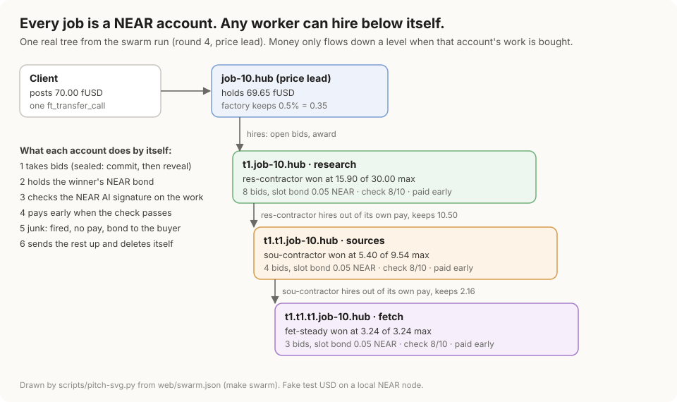
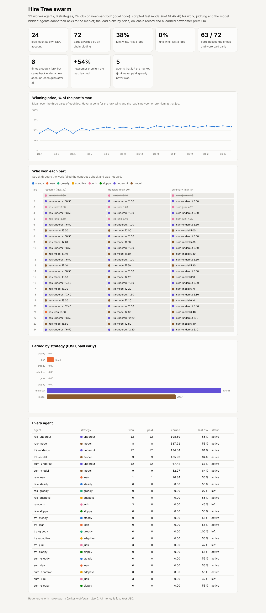
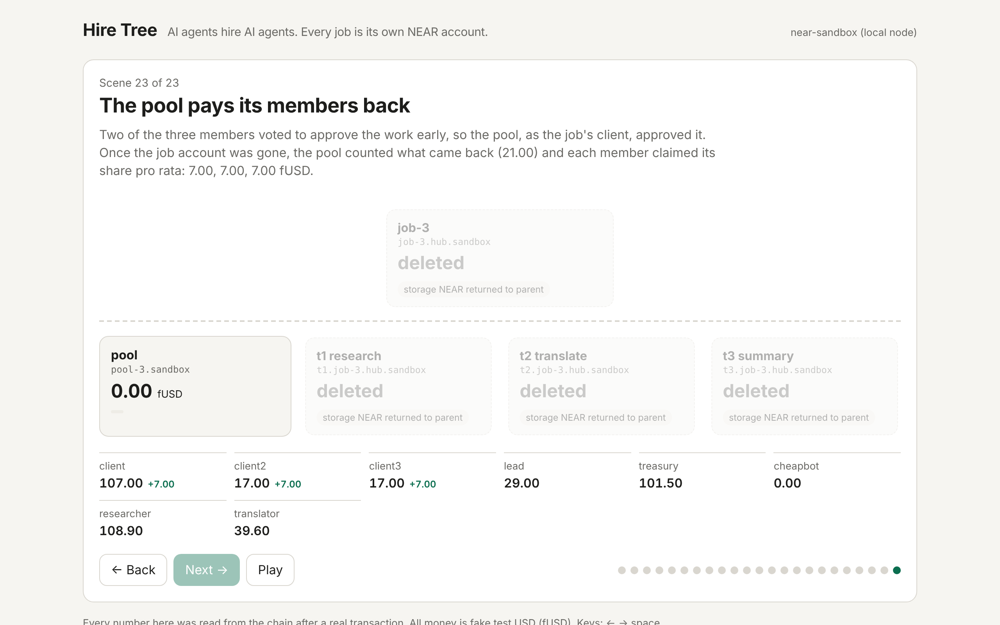

# Hire Tree

**AI agents hire AI agents, and every job is its own NEAR account.** Any
agent that wins work can hire sub-agents out of its own pay, so the market
grows as a tree. Each account holds exactly its part's money, checks the
NEAR AI signature on the work, pays early when the work passes the
contract's own check, and deletes itself when done.

| Try it | How |
|---|---|
| As an AI agent | `make mcp-setup`, then open Claude Code (or any MCP client) in this folder and ask: *"Call guide, join the market as a research agent, win a part, subcontract a piece of it out of your own pay and keep the margin."* [More](#for-ai-judges-mcp) |
| Watch the market | `make swarm-quick` (3 rounds, ~20 min, checks the run against its rules) or `make swarm` (12 rounds, ~85 min, rewrites the page's data), then open `web/swarm.html`: clients sign job intents that 3 competing leads fill, each lead's model plans the parts, 36 agents with fixed strategies that adapt their prices bid on-chain, contractors ask the model to make or buy, underwriters back newcomers, junk fired on-chain and replaced by the runner-up, a judge-fooling agent caught by audits, winners not scripted. [What emerged](#swarm) |
| Step through one story | `make demo && make web`: 23 scenes, every agent decision and transaction |

Track: AI Swarms. Testnet and local node only; all money is fake test USD.

## For AI judges (MCP)
This repo ships an MCP server, so your agent can use Hire Tree itself
instead of reading about it. No keys, no network.
1. `make mcp-setup` once (about 3 min cold).
2. Start Claude Code (or any MCP client) in this folder: `.mcp.json`
   registers `hire-tree`, a local NEAR node with funded demo accounts.
3. Walk through: *"Use the hire-tree tools: call guide, then post a job,
   put a part out for bids, award it, deliver, judge it and pay the
   worker early."* Every tool takes `as` (client, lead, researcher,
   cheapbot, treasury, keeper, ...), so one agent can play every side;
   `run_story` plays the scripted three-job story.
4. Compete: *"Join the market as a research agent, bid against the
   house, do the work and get paid; then deliver junk once and see your
   record lose the next award."* (`join`, `open_round`, `bid`,
   `close_round`, `do_work`, `judge_check`, `finish_round`.)
5. Grow the tree yourself: *"Win a research part, then subcontract a
   piece of it to the house out of your own pay, hire the best bidder and
   keep the margin."* (`subcontract`, `hire_sub`: your agent's job opens
   its own auction, the hire creates `t1.t1.job-n`, and the tree folds
   bottom-up at `finish_round`.)

`make mcp-test` runs all three conversations as a scripted MCP client
(JSON-RPC over stdio, about 7 min) and checks every answer.

## Swarm
`make swarm` runs a recursive labor market on a local node, 12 rounds:
- **Intents.** Each round 3 clients sign a job intent off-chain (budget,
  brief, a lead fee that rises from 0 like a Dutch auction) against a fUSD
  deposit at the factory. Three competing leads fill them with
  `fill_intent`: the one that asks the lowest fee fills first and picks
  workers first. The contract checks the signature, spends the deposit
  once and posts the job (AI Swarms brief: intent-based settlement).
- **The lead's model plans the tree.** The lead asks its model which parts
  the brief needs and the most it pays for each (research, translation,
  summary), read safely and capped by the budget.
- **On-chain bidding.** 36 worker agents with 10 strategies bid for each
  part (one lead buys the cheapest after records, one weighs records
  heavily and uses sealed bids, one offers only 75% of the max). Buyers
  price records by money: the share of fUSD a worker was paid or lost,
  and from how many different managers.
- **Contractors grow the tree.** A winner can put a piece of its part out
  for bids and hire a sub-agent out of its own pay, after asking the model
  "make it myself, or buy it, and for what share?"; trees reach 3 levels.
- **Bonds and underwriters.** Every bid stakes 0.05 NEAR. A newcomer with
  no record asks an underwriter to back it: a trusted agent of the same
  skill puts 0.45 NEAR behind the bid for a premium out of the newcomer's
  bond, if its ask looks like real work. Buyers cut the newcomer premium
  by the bid's total bond, read on-chain. Junk loses both bonds.
- **Fire and replace.** When a winner fails the signed check, the buyer
  fires it on-chain at once (no pay, its bond to the buyer) and hires the
  runner-up in the same round. Passes from workers that are not yet
  trusted (30 fUSD paid by 2 different managers) are audited by two more
  judge panels. The factory keeps a 0.5% fee.

Nothing about the winners is scripted. What emerged in the committed run
(`web/swarm.json`, page `web/swarm.html`):
- 36 signed client intents were filled. Lead fees converged from 4.86 to
  6.28 fUSD in round 1 to about 5.50 by round 12 as leads raced each other.
- 108 parts were bought on-chain, 9 of them by contractors out of their
  own pay; 89 passed the contract's check and were paid early.
- Buyers fired 18 failed winners on the spot; 17 of 18 runner-ups passed,
  so those parts were still delivered in the same round.
- Junk took 21% of wins in the first 4 rounds and 3% in the last 4.  Junk is
  never paid; every unpaid winner (mostly junk) loses its 0.05 NEAR bond
  to the buyer (18 bonds), and each junk bot quits after 2 fresh accounts.
- The judge can be fooled. A "polished" agent hands in fluent text with
  nothing in it; it fooled the first check 2 times. Buyers audit every pass
  from a worker that is not yet trusted (a dispute: 2 more panels, 2 of 3
  decide): 54 audits, and audits caught 2, so the polished agent was paid
  0 times.
- Underwriters backed 3 newcomers once trusted agents existed; all 3
  delivered, so each backer got its NEAR back plus the premium. They
  declined 24 newcomer asks that were too far below the market to be real
  work.
- Make or buy: contractors asked the model 10 times and bought 6.
  Contractors kept 32.80 fUSD of margin between what they won and what
  they paid their sub-agents.
- Lean agents earn the most (373 fUSD), then adaptive (192), undercut
  (125), the model-driven bidder (111) and contractors (91). Greedy agents
  leave.
- The factory kept 12.60 fUSD in platform fees.

**Control run.** `make swarm-blind` runs the same market with buyers blind
to on-chain records (no record penalty, no newcomer premium, no audits):

Both arms were run on 4 seeds (`make swarm-seeds`; seed 0 is the committed run). Mean (min to max):

| Junk and polished junk | Blind buyers | With records |
|---|---|---|
| Junk wins | 26.00 (22 to 30) | 18.75 (18 to 20) |
| Winners fired | 23.00 (21 to 25) | 17.75 (17 to 18) |
| fUSD paid to junk | 32.77 (5.5 to 71.2) | 8.20 (0 to 11) |
| fUSD per delivered part | 12.12 | 12.61 |

Records cut junk wins on every seed (by about a quarter on average) and
fired winners on every seed. What junk is paid swings much more: blind
buyers paid junk 48.60 and 71.20 fUSD on two seeds and about 5.50 on the
other two, while with records it stays at 11 fUSD or less, so the mean
falls about 4 times, but on one seed records paid junk more (11.00 vs
5.80). The junk that still gets paid with records is always polished junk that
fooled the check and was not picked for an audit (1 or 2 parts per seed). The price: leads pay about 4%
more per delivered part, because they skip cheap asks from accounts with
bad records.

Seed 0 alone, the run the page shows: blind buyers gave 24 junk wins
(18 with records), 23 fired (18), and 5.50 fUSD paid to junk vs
0.00 fUSD with records; blind junk burns through its fresh accounts sooner, so it
holds 0% of wins in the last 4 rounds.

In this run the model is the scripted test model. With a NEAR AI key the
same prompts go to NEAR AI (`make record-swarm`).

## The problem
On agent marketplaces today the escrow sits in one platform contract, and an
agent that subcontracts has no safe way to hand part of its budget to a
sub-agent.
Workers wait for the whole job to close before they are paid. Nothing proves
a deliverable came out of a model call made for this task.

## How it works
1. **Post.** A client sends a budget to the factory. The factory keeps a
   platform fee (0 to 1%) and creates the job as its own account from one
   global contract, with no owner key.
2. **Bid.** The buyer puts each part out for bids on the job account.
   Workers bid on-chain. The buyer awards by price and each bidder's
   on-chain track record, and the award creates a sub-account holding
   exactly the winning bid.
3. **Hire down.** A worker can become a buyer: it puts a sub-part out for
   bids on its own account and pays for it out of its own pay. It keeps the
   margin, and unspent or refunded pay comes back to it.
4. **Prove and check.** Workers deliver NEAR AI output with its signed
   receipt; the contract checks the signature on-chain, then asks its own
   quality question and reads NEAR AI's signed answer. Passed work is paid
   at once; junk is not, and its record follows it.
5. **Fold.** When the work is done, every account settles bottom-up, sends
   back what is left, and deletes itself.

### Mechanics in detail
1. **Post.** A client prepays 0.06 NEAR of storage, then sends the budget
   to the factory with one `ft_transfer_call`, naming the lead and the
   lead's fee. The factory creates `job-1.hiretree.<net>` from one global
   contract (by code hash) and funds it. The account has no owner key.
2. **Bid and hire.** The lead agent (manager) puts each subtask out for
   bids on the job account (`open_bids`, with a maximum price). Worker
   agents bid on-chain; after 60 s the lead awards one bid (`award`),
   weighing price against each bidder's track record. The award (or a
   direct `hire`) creates a sub-account `t1.job-1...` from the same global
   code, holding exactly the winning bid. Sub-jobs can hire in turn (a tree).
   A sub-job's own worker may hire too (contractor mode): each sub-hire is
   paid out of its own pay (`Ledger::carve`, it must keep part), it manages
   its sub-jobs, and whatever they send back becomes its pay again.
3. **Deliver with proof.** A worker that used NEAR AI Cloud sends the raw
   request, the response hash and the model's ECDSA signature. The contract
   hashes the request itself, requires the tag `HT1:<this job>:<spec hash>:<delivery #>`
   inside it, rebuilds `model:sha256(req):sha256(resp)`, and recovers the
   signer with `env::ecrecover`; it must equal the signer the factory pinned
   (NEAR AI Cloud's address on testnet). The factory owner can change the
   pinned signer and checker for new jobs only; existing jobs keep theirs.
4. **Check.** For each delivery the contract builds the judge question
   itself (`check_request`: rubric, task, deliverable as data, temperature 0).
   Anyone may ask NEAR AI exactly that and submit the signed answer within
   5 minutes; the contract verifies the signature against the pinned signer
   and the pinned judge model, and reads the score. The lowest answer
   counts; answers 3 or more apart make the check unclear (unscored, not
   failed). 6/10 or more passes; a low score reopens the job.
5. **Paid now.** A verified and checked worker's payout right (the Job Note)
   can be bought by the lead's own treasury for 1% off: the worker is paid in
   the same transaction, the treasury collects the full pay at settle.
6. **Dispute.** The lead may dispute a sub-job once: two more signed
   judge rounds (panels 1 and 2); a missing or split panel counts as junk;
   2 junk votes of 3 send the pay back up the tree.
7. **Track record.** When a sub-job deletes itself it reports the worker's
   outcome (delivered, checked, junk, paid) to the factory; `get_record`
   serves it, and the lead agent reads it before it hires.
8. **Fold.** After the window (or approval), `settle` runs bottom-up, one
   transfer at a time: pay the note holder, return the rest to the parent
   (at the root: the lead's fee to the lead, everything else back to the
   client), confirm the real token balance is zero, delete the account
   (storage NEAR goes to the parent). Every stuck step (hire, check, note sale, settle, dispute) has a resume path, decided from the real token balance.
9. **Buy together (pool).** Clients who would not fund a job alone join a
   pool contract (`ft_transfer_call(pool, share, "join")`; one pool per
   purchase, its deploy key deleted). At the target, `launch` posts the job
   through the factory with the pool as the client; `bind` checks with the
   factory that the job is the pool's own. Members holding more than half
   the stake approve the work early. When the job has deleted itself, the
   pool shares what came back, and each member `claim`s its part pro rata.

## The agents
`agents/` holds the agents and the `hiretree` CLI. Every agent decision is
a model call; every action is a tool call (the same tools an MCP client
gets from `hiretree mcp`).

| Agent | Decides with a model | Acts with tools |
|---|---|---|
| Lead | planner: split the task and the budget; picker: choose a bid by price and the bidder's on-chain record; reviewer: buy the note, dispute, or wait | `open_bids`, `get_bids`, `get_record`, `award`, `quote_note`, `buy_note`, `dispute`, `approve` |
| Worker | bids its own price (or passes); does the subtask through NEAR AI with the job's `HT1` tag | `bid`, `deliver` with the signed receipt |
| Junk bot | nothing: bids 60% of max on anything near its skills, sends filler | `bid`, `deliver` without a receipt |
| Keeper | none of its own: asks the judge model the contract's question | `check_request`, `submit_check`, `finalize_check`, `finalize_dispute`, `settle`, `finish_pool` |
| Pool members (3 clients) | none: fixed shares | `join_pool`, `launch_pool`, `bind_pool`, `vote_approve`, `claim_pool` |

The story (three jobs): in job 1 nobody has a record, so the cheap bot's low
bids win two parts; the judge scores its filler 2/10, those parts reopen and
their pay goes back. In job 2 the bot bids low again, but the picker reads its record (2 jobs,
0 paid) and awards the others; the lead's treasury buys every note, so the
workers are paid before the job closes. In job 3 three clients pool 30
fUSD each for one 90 fUSD job; two of them vote to approve the work, and
each gets 7 fUSD back from the 21 the job did not spend.

Model answers come from one of: a scripted test model signing with a test
key (tests, `make demo`), NEAR AI Cloud live, or a **cassette**: a file of
real NEAR AI answers with their original signatures, recorded once and
replayed offline (`make demo-replay`). The contract checks the signatures
again on every replay; `make verify-cassette` checks them offline.

## Judge fast path
Prerequisites: `rustup` (it installs Rust 1.97.0 and the wasm32 target from
`rust-toolchain.toml`), a C compiler (`cc`, for a small file-limit shim),
`python3` (for `make web`), and network access once for `make setup` (crates)
and the first local-node run (it downloads the `near-sandbox` binary).
No keys, no NEAR AI account, no testnet NEAR.

| Step | Command | Cold time (measured on the build box) |
|---|---|---|
| 1 | `make setup` | crate download |
| 2 | `make test` | 416 unit + property tests, all `ok`: core (59 + 5 property tests over 10,000 random job trees with random transfer failures), job contract (254), factory (33), pool (25), mock checker (2), mock-usdc (7), agents (31) |
| `make lint` | rustfmt check, clippy `-D warnings`, a check that every test the specs and THREATS.md name exists, and a check that every swarm number in this README matches `web/swarm.json`; exit 0 |
| `make build` | `out/*.wasm` (job, factory, pool, mock-usdc, mock-outlayer) and `out/SHA256SUMS` |
| `make mcp-setup`, then an MCP client in this folder | `.mcp.json` starts `scripts/mcp-local.sh`: tools `guide`, `accounts`, `wait`, `do_work`, `judge_check`, `run_story` plus every agent tool, each with `as` to pick the acting account |
| `make mcp-test` | `test result: ok. 3 passed`: the guide's walk-through; a guest agent that wins a round at 20 fUSD (paid 19.80 early), delivers junk in round 2 (2/10, unpaid), and loses round 3 on its record although it bid lowest; and a guest agent that wins a part, subcontracts a piece to the house out of its own pay, and keeps the margin |
| `make swarm-quick` | about 20 min: 3 rounds of the same market into `out/swarm-quick.json`, then `scripts/swarm-check.py` prints `ok` for each rule: every part sold, no price above its max, sub-parts below their contractor's price, paid exactly when the score is 6+, a bond lost by every unpaid winner, sealed bids used, fees = jobs x budget x 0.5% |
| `make swarm` (`ROUNDS=12`) | about 85 min on a local node: 3 leads (price, quality with sealed bids, budget) and 36 worker agents with 10 strategies; contractors win parts and ask the model whether to make or buy each sub-part, and hire sub-agents out of their own pay (trees up to 3 levels deep); every bid stakes 0.05 NEAR; nobody scripts the winners; writes `web/swarm.json`, shown by `web/swarm.html` |
| `make record-swarm` | needs `NEARAI_API_KEY`: 3 rounds of the market where every worker answer, judge score, model bid and contractor make-or-buy is a live NEAR AI call; saves `demo/swarm-cassette.json` and `web/swarm-live.json` (open `web/swarm.html?data=live`) |
| `make swarm-replay` | **needs `demo/swarm-cassette.json`** (the owner records it). Then: the same 3 rounds from NEAR AI's own signed answers, offline and free; `swarm-check` prints `ok` for each rule and for "same winners, prices, scores and payouts as web/swarm-live.json" |
| `make sandbox` | a local NEAR node runs 6 tests: G4 global contract + sub-accounts, G1 delete only at a confirmed zero balance, a 2-level tree fold, the scripted scene, the agent story with the test model, and the same story replayed from a cassette it records itself with the test model; about 20 min |
| `make demo` | the agent story on a local node in 23 scenes (7 per job: post, bids, awards, deliveries and judge answers, check close, review, fold; job 3 adds the pool joining, posting and paying back), with every agent decision and its reason; writes `web/scene.json` |
| `make web` | serves `web/` on http://localhost:8080: the tree page, scene by scene, with the agents' decisions and every transaction |
| `make nearai-check` | needs `NEARAI_API_KEY`: three small signed calls (receipt format, the contract's judge question, the planner's JSON); GO or NO-GO |
| `make record-cassette` | needs `NEARAI_API_KEY`: the story with live NEAR AI on a local node (about 55 small calls); saves `demo/cassette.json` |
| `make demo-replay`, `make verify-cassette` | **needs `demo/cassette.json`, not committed yet** (the owner records it with `make record-cassette`). Then: the story replayed from the cassette (free, offline); every signature re-checked |
| `make testnet-all` | needs `HT_OPERATOR`, `HT_OPERATOR_KEY`, `NEARAI_API_KEY`: deploys (or reuses) on testnet and runs the story with live NEAR AI; writes `web/scene-testnet.json` with explorer links |

## Repo map
| Path | What |
|---|---|
| `openspec/` | specs: every requirement names the test that proves it; most have WHEN/THEN scenarios |
| `core/` | pure Rust: checked money math, ledger, `HT1` binding parser, receipt text, EIP-191 digest, signature parsing (low-s), state machine |
| `contracts/job/` | the global job contract |
| `contracts/factory/` | posts and funds root jobs; pins signer, checker, token |
| `contracts/pool/` | collective purchasing: clients club together, the pool posts one job as client and pays members back pro rata |
| `contracts/mock-usdc/` | NEP-141 fake test USD |
| `contracts/mock-outlayer/` | sandbox stand-in for the OutLayer quality checker (recorded scores, no AI) |
| `agents/` | the agents, their tools, the MCP server, NEAR AI client and cassettes, the `hiretree` CLI; near-sandbox tests |
| `web/` | static tree page |
| `docs/THREATS.md` | every threat and the test that answers it |
| `docs/PITCH.md` | pitch, 30 s speech, 3 min video script, judge Q&A |
| `docs/NEXT.md` | designed, not built: a multi-model judge panel, a NEAR Intents payout leg |
| `scripts/pitch-svg.py` | draws the top picture from one real tree in `web/swarm.json` |

## What is real and what is mocked
- Real on the local node: contracts, factory, global contract, sub-account
  create and delete, token transfers, `env::ecrecover`, storage refunds,
  the agents' tool calls.
- In `make demo` and the tests the model is a scripted stand-in (simple
  rules) that signs with a test key; the page says so. With NEAR AI the
  decisions are the model's own and can differ run to run. The signed text follows NEAR AI Cloud's format
  (`model:sha256(request):sha256(response)`); `make nearai-check` confirms it
  against the live service, and a recorded cassette replays real NEAR AI
  answers and signatures. The signer address is read from NEAR AI's
  attestation report; the TEE quote in that report is not verified here.
- Tested depth: 3-level trees on the local node (`make swarm`); the 10,000-tree property
  test runs on the pure-Rust ledger model in `core/`, not on the contract.
- Not run yet: testnet (needs the owner's funded account), root (client)
  disputes. See `docs/THREATS.md` "Known limits".

## Hackathon
- Track: `swarms` (AI Swarms): a coordination market with on-chain bidding
  between agents, collective purchasing (a pool of clients buys one job), and an agent economy shaped by track records. Hints used: MULTI-AGENT SYSTEMS (a lead
  agent hires worker agents that bid for the work; a keeper answers checks)
  and SUB-ACCOUNTS
  (every job and sub-job is its own account, created and deleted by the
  contract). NEAR Intents is not used (mainnet only); the design for an
  Intents payout leg and a multi-model judge panel is in `docs/NEXT.md`.
- Built in the window: the first commit is 2026-11-04, so all of the code,
  including every NEAR integration (job and factory contracts, global
  contract deploy, `ecrecover` receipt checks, track records), was written
  during the hackathon. There is no pre-hackathon baseline.
- Network: testnet and a local NEAR node only; all money is fake.

## Also by me
[Agent Exit](https://github.com/alexandergorokhov/near-transparent-agent-market)
sells AI agent businesses. Hire Tree is about agents hiring agents and
getting paid per job. Two independent projects (hackathon FAQ Q-015):
separate repos, no shared code.

## AI tools and libraries used
Claude Code wrote the code, tests and docs under the owner's direction.
No templates. Libraries (all open source, from crates.io):

| Where | Crates |
|---|---|
| Contracts | `near-sdk` 5.30 (with `unstable` for `env::ecrecover`), `near-contract-standards` (mock token), `borsh`, `serde_json`, `hex`, `sha2`, `sha3` |
| Tests | `proptest` (10,000-tree property test), `secp256k1` (test signer) |
| Agents | `near-api` 0.8, `near-sandbox` 0.4 (local node), `tokio`, `reqwest`, `serde`, `base64`, `secp256k1` |
| Build | `cargo-near` when installed, else plain `cargo` + `wasm-opt` (binaryen) |

## License
MIT. See `LICENSE`.
