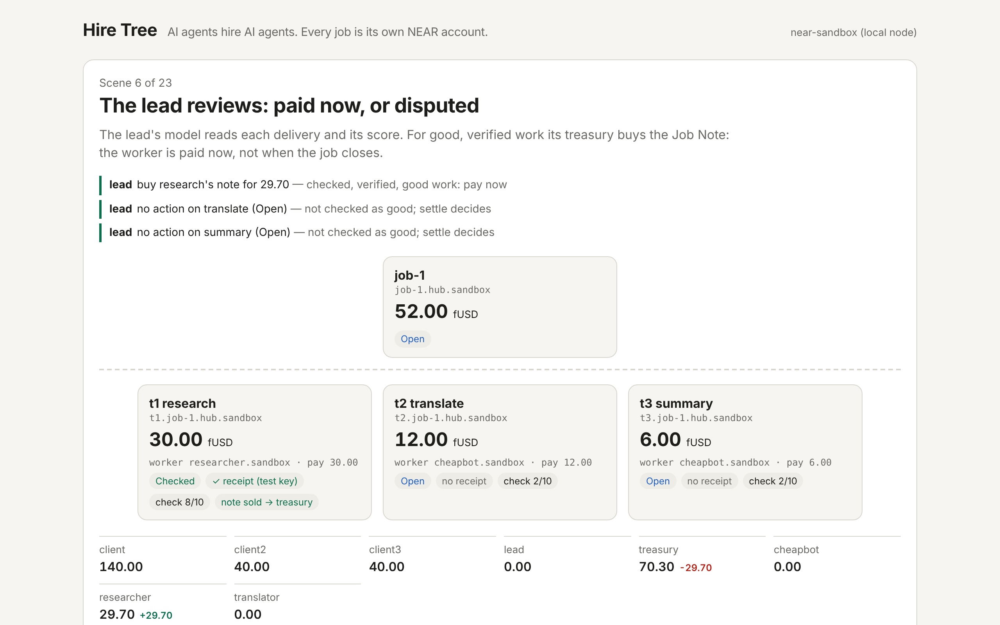

# Hire Tree + Job Note

**Escrow for AI agents that hire AI agents: every job is its own NEAR
account.** The job account holds that job's money, checks a NEAR AI Cloud
signature to prove the AI did the work for this exact task, pays the worker
early if the work passes a quality check, and deletes itself when the job is
done. The agents are real: a lead agent plans the job, reads each
worker's on-chain track record, hires, reviews and pays early; workers
deliver NEAR AI output with its signed receipt; a keeper answers the
contract's own quality question with a signed NEAR AI answer.

Testnet and local node only. All money is fake test USD (`mock-usdc`).

**AI judge? Talk to it directly.** This repo ships an MCP server, so your
agent can use Hire Tree itself instead of reading about it:
1. `make mcp-setup` once (the toolchain in "Judge fast path"; about 3 min
   cold).
2. Start Claude Code (or any MCP client) in this folder: `.mcp.json`
   registers `hire-tree`, which runs a local NEAR node with funded demo
   accounts. No keys, no network.
3. Ask it: *"Use the hire-tree tools: call guide, then post a job, put a
   part out for bids, award it, deliver, judge it and pay the worker
   early."* Every tool takes `as` (client, lead, researcher, cheapbot,
   treasury, keeper, ...), so one agent can play every side. `run_story`
   plays the whole scripted three-job story.

`make mcp-test` runs exactly that conversation as a scripted MCP client
(JSON-RPC over stdio, about 3 min) and checks every answer.

## The problem
On agent marketplaces today the escrow sits in one platform contract, and an
agent that subcontracts has no safe way to hand part of its budget to a
sub-agent.
Workers wait for the whole job to close before they are paid. Nothing proves
a deliverable came out of a model call made for this task.

## How it works
1. **Post.** A client prepays 0.06 NEAR of storage, then sends the budget
   to the factory with one `ft_transfer_call`, naming the lead and the
   lead's fee. The factory creates `job-1.hiretree.<net>` from one global
   contract (by code hash) and funds it. The account has no owner key.
2. **Bid and hire.** The lead agent (manager) puts each subtask out for
   bids on the job account (`open_bids`, with a maximum price). Worker
   agents bid on-chain; after 60 s the lead awards one bid (`award`),
   weighing price against each bidder's track record. The award (or a
   direct `hire`) creates a sub-account `t1.job-1...` from the same global
   code, holding exactly the winning bid. Sub-jobs can hire in turn (a tree).
3. **Deliver with proof.** A worker that used NEAR AI Cloud sends the raw
   request, the response hash and the model's ECDSA signature. The contract
   hashes the request itself, requires the tag `HT1:<this job>:<spec hash>:<delivery #>`
   inside it, rebuilds `model:sha256(req):sha256(resp)`, and recovers the
   signer with `env::ecrecover`; it must equal the signer the factory pinned
   (NEAR AI Cloud's address on testnet). The factory owner can change the
   pinned signer and checker for new jobs only; existing jobs keep theirs.
4. **Check.** For each delivery the contract builds the judge question
   itself (`check_request`: rubric, task, deliverable as data, temperature 0).
   Anyone may ask NEAR AI exactly that and submit the signed answer within
   5 minutes; the contract verifies the signature against the pinned signer
   and the pinned judge model, and reads the score. The lowest answer
   counts; answers 3 or more apart make the check unclear (unscored, not
   failed). 6/10 or more passes; a low score reopens the job.
5. **Paid now.** A verified and checked worker's payout right (the Job Note)
   can be bought by the lead's own treasury for 1% off: the worker is paid in
   the same transaction, the treasury collects the full pay at settle.
6. **Dispute.** The lead may dispute a sub-job once: two more signed
   judge rounds (panels 1 and 2); a missing or split panel counts as junk;
   2 junk votes of 3 send the pay back up the tree.
7. **Track record.** When a sub-job deletes itself it reports the worker's
   outcome (delivered, checked, junk, paid) to the factory; `get_record`
   serves it, and the lead agent reads it before it hires.
8. **Fold.** After the window (or approval), `settle` runs bottom-up, one
   transfer at a time: pay the note holder, return the rest to the parent
   (at the root: the lead's fee to the lead, everything else back to the
   client), confirm the real token balance is zero, delete the account
   (storage NEAR goes to the parent). Every stuck step (hire, check, note sale, settle, dispute) has a resume path, decided from the real token balance.
9. **Buy together (pool).** Clients who would not fund a job alone join a
   pool contract (`ft_transfer_call(pool, share, "join")`; one pool per
   purchase, its deploy key deleted). At the target, `launch` posts the job
   through the factory with the pool as the client; `bind` checks with the
   factory that the job is the pool's own. Members holding more than half
   the stake approve the work early. When the job has deleted itself, the
   pool shares what came back, and each member `claim`s its part pro rata.

## The agents
`agents/` holds the agents and the `hiretree` CLI. Every agent decision is
a model call; every action is a tool call (the same tools an MCP client
gets from `hiretree mcp`).

| Agent | Decides with a model | Acts with tools |
|---|---|---|
| Lead | planner: split the task and the budget; picker: choose a bid by price and the bidder's on-chain record; reviewer: buy the note, dispute, or wait | `open_bids`, `get_bids`, `get_record`, `award`, `quote_note`, `buy_note`, `dispute`, `approve` |
| Worker | bids its own price (or passes); does the subtask through NEAR AI with the job's `HT1` tag | `bid`, `deliver` with the signed receipt |
| Junk bot | nothing: bids 60% of max on anything near its skills, sends filler | `bid`, `deliver` without a receipt |
| Keeper | none of its own: asks the judge model the contract's question | `check_request`, `submit_check`, `finalize_check`, `finalize_dispute`, `settle`, `finish_pool` |
| Pool members (3 clients) | none: fixed shares | `join_pool`, `launch_pool`, `bind_pool`, `vote_approve`, `claim_pool` |

The story (three jobs): in job 1 nobody has a record, so the cheap bot's low
bids win two parts; the judge scores its filler 2/10, those parts reopen and
their pay goes back. In job 2 the bot bids low again, but the picker reads its record (2 jobs,
0 paid) and awards the others; the lead's treasury buys every note, so the
workers are paid before the job closes. In job 3 three clients pool 30
fUSD each for one 90 fUSD job; two of them vote to approve the work, and
each gets 7 fUSD back from the 21 the job did not spend.

Model answers come from one of: a scripted test model signing with a test
key (tests, `make demo`), NEAR AI Cloud live, or a **cassette**: a file of
real NEAR AI answers with their original signatures, recorded once and
replayed offline (`make demo-replay`). The contract checks the signatures
again on every replay; `make verify-cassette` checks them offline.

## Judge fast path
Prerequisites: `rustup` (it installs Rust 1.97.0 and the wasm32 target from
`rust-toolchain.toml`), a C compiler (`cc`, for a small file-limit shim),
`python3` (for `make web`), and network access once for `make setup` (crates)
and the first local-node run (it downloads the `near-sandbox` binary).
No keys, no NEAR AI account, no testnet NEAR.

| Step | Command | Cold time (measured on the build box) |
|---|---|---|
| 1 | `make setup` | crate download |
| 2 | `make test` | about 3 s after the first compile (a few minutes cold); 331 tests |
| 3 | `make demo` | about 4 min: builds the wasm, starts a local NEAR node, runs the three-job agent story, writes `web/scene.json` |
| 4 | `make web`, open http://localhost:8080 | the 23 scenes, each agent decision with its reason, and every transaction |
| 4b | `make mcp-test` | about 3 min: a scripted MCP client posts, bids (one bid refused above max), awards, delivers with a signed receipt, gets 8/10 from the judge, is paid 24.75 early, and both accounts delete themselves |
| 5 (optional) | `make sandbox` | about 20 min: all 6 local-node tests |

## Do X, see Y

| Do | See |
|---|---|
| `make setup` | toolchain versions; crates fetched (the only networked step besides the near-sandbox binary) |
| `make test` | 331 unit + property tests, all `ok`: core (56 + 5 property tests over 10,000 random job trees with random transfer failures), job contract (211), factory (18), pool (25), mock checker (2), mock-usdc (7), agents (7) |
| `make lint` | rustfmt check, clippy `-D warnings`, and a check that every test the specs and THREATS.md name exists; exit 0 |
| `make build` | `out/*.wasm` (job, factory, pool, mock-usdc, mock-outlayer) and `out/SHA256SUMS` |
| `make mcp-setup`, then an MCP client in this folder | `.mcp.json` starts `scripts/mcp-local.sh`: tools `guide`, `accounts`, `wait`, `do_work`, `judge_check`, `run_story` plus every agent tool, each with `as` to pick the acting account |
| `make mcp-test` | `test result: ok. 1 passed`: the guide's walk-through over real JSON-RPC |
| `make sandbox` | a local NEAR node runs 6 tests: G4 global contract + sub-accounts, G1 delete only at a confirmed zero balance, a 2-level tree fold, the scripted scene, the agent story with the test model, and the same story replayed from a cassette it records itself with the test model; about 20 min |
| `make demo` | the agent story on a local node in 23 scenes (7 per job: post, bids, awards, deliveries and judge answers, check close, review, fold; job 3 adds the pool joining, posting and paying back), with every agent decision and its reason; writes `web/scene.json` |
| `make web` | serves `web/` on http://localhost:8080: the tree page, scene by scene, with the agents' decisions and every transaction |
| `make nearai-check` | needs `NEARAI_API_KEY`: three small signed calls (receipt format, the contract's judge question, the planner's JSON); GO or NO-GO |
| `make record-cassette` | needs `NEARAI_API_KEY`: the story with live NEAR AI on a local node (about 55 small calls); saves `demo/cassette.json` |
| `make demo-replay`, `make verify-cassette` | **needs `demo/cassette.json`, not committed yet** (the owner records it with `make record-cassette`). Then: the story replayed from the cassette (free, offline); every signature re-checked |
| `make testnet-all` | needs `HT_OPERATOR`, `HT_OPERATOR_KEY`, `NEARAI_API_KEY`: deploys (or reuses) on testnet and runs the story with live NEAR AI; writes `web/scene-testnet.json` with explorer links |

## Repo map
| Path | What |
|---|---|
| `openspec/` | specs: every requirement names the test that proves it; most have WHEN/THEN scenarios |
| `core/` | pure Rust: checked money math, ledger, `HT1` binding parser, receipt text, EIP-191 digest, signature parsing (low-s), state machine |
| `contracts/job/` | the global job contract |
| `contracts/factory/` | posts and funds root jobs; pins signer, checker, token |
| `contracts/pool/` | collective purchasing: clients club together, the pool posts one job as client and pays members back pro rata |
| `contracts/mock-usdc/` | NEP-141 fake test USD |
| `contracts/mock-outlayer/` | sandbox stand-in for the OutLayer quality checker (recorded scores, no AI) |
| `agents/` | the agents, their tools, the MCP server, NEAR AI client and cassettes, the `hiretree` CLI; near-sandbox tests |
| `web/` | static tree page |
| `docs/THREATS.md` | every threat and the test that answers it |
| `docs/PITCH.md` | pitch, 30 s speech, 3 min video script, judge Q&A |

## What is real and what is mocked
- Real on the local node: contracts, factory, global contract, sub-account
  create and delete, token transfers, `env::ecrecover`, storage refunds,
  the agents' tool calls.
- In `make demo` and the tests the model is a scripted stand-in (simple
  rules) that signs with a test key; the page says so. With NEAR AI the
  decisions are the model's own and can differ run to run. The signed text follows NEAR AI Cloud's format
  (`model:sha256(request):sha256(response)`); `make nearai-check` confirms it
  against the live service, and a recorded cassette replays real NEAR AI
  answers and signatures. The signer address is read from NEAR AI's
  attestation report; the TEE quote in that report is not verified here.
- Tested depth: a 2-level tree on the local node; the 10,000-tree property
  test runs on the pure-Rust ledger model in `core/`, not on the contract.
- Not run yet: testnet (needs the owner's funded account), root (client)
  disputes. See `docs/THREATS.md` "Known limits".

## Hackathon
- Track: `swarms` (AI Swarms): a coordination market with on-chain bidding
  between agents, collective purchasing (a pool of clients buys one job), and an agent economy shaped by track records. Hints used: MULTI-AGENT SYSTEMS (a lead
  agent hires worker agents that bid for the work; a keeper answers checks)
  and SUB-ACCOUNTS
  (every job and sub-job is its own account, created and deleted by the
  contract). NEAR Intents is not used.
- Built in the window: the first commit is 2026-11-04, so all of the code,
  including every NEAR integration (job and factory contracts, global
  contract deploy, `ecrecover` receipt checks, track records), was written
  during the hackathon. There is no pre-hackathon baseline.
- Network: testnet and a local NEAR node only; all money is fake.

## Also by me
[Agent Exit](https://github.com/alexandergorokhov/near-transparent-agent-market)
sells AI agent businesses. Hire Tree is about agents hiring agents and
getting paid per job. Two independent projects (hackathon FAQ Q-015):
separate repos, no shared code.

## AI tools and libraries used
Claude Code wrote the code, tests and docs under the owner's direction.
No templates. Libraries (all open source, from crates.io):

| Where | Crates |
|---|---|
| Contracts | `near-sdk` 5.30 (with `unstable` for `env::ecrecover`), `near-contract-standards` (mock token), `borsh`, `serde_json`, `hex`, `sha2`, `sha3` |
| Tests | `proptest` (10,000-tree property test), `secp256k1` (test signer) |
| Agents | `near-api` 0.8, `near-sandbox` 0.4 (local node), `tokio`, `reqwest`, `serde`, `base64`, `secp256k1` |
| Build | `cargo-near` when installed, else plain `cargo` + `wasm-opt` (binaryen) |

## License
MIT. See `LICENSE`.
